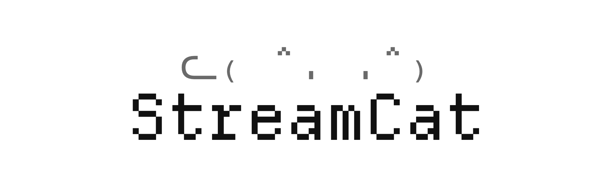

<p align="center">
  <picture>
    <source media="(prefers-color-scheme: dark)" srcset=".github/assets/hero-dark.png" />
    
  </picture>
</p>

<p align="center">
  <a href="https://philbode.github.io/StreamCat/"></a>
  
  
  
  
</p>

<p align="center">
  Discord bot for Twitch live alerts and Spotify song requests, with a web dashboard
  and an OBS overlay editor.
</p>

StreamCat announces Twitch streams in Discord, takes Spotify song requests, and gives you a
drag-and-drop editor for your OBS overlay. Build scenes with chat, text, images, videos and
music widgets, then add each scene to OBS with one browser-source link.

## Features

- **Live alerts** — announce Twitch streams in the right Discord channel.
- **Song requests** — queue Spotify tracks from stream chat and show the current song.
- **Overlay editor** — drag widgets on a 1920×1080 canvas and save reusable scenes.
- **Dashboard** — manage Discord servers, connections and scenes from the browser.
- **Self-hosted** — Bun, PostgreSQL and Garage, deployed with Docker Compose.

## Live demo

Try the static demo at **[philbode.github.io/StreamCat](https://philbode.github.io/StreamCat/)**.

The demo includes the dashboard, a mocked server settings view and the real overlay editor.
It uses mock data and keeps changes in your browser. It needs no account and no backend, and
cannot connect to Discord, Twitch, Spotify or OBS.

Run it locally with `bun install && bun run dev:demo`.

Deployment uses GitHub Actions; the repository Pages source must be set to **GitHub Actions**.

## Quick start

You need [Bun](https://bun.sh) and Docker.

1. Copy `.env.example` to `.env` and fill in the provider credentials.
2. Set `PUBLIC_URL` to your public HTTPS domain. With Cloudflare, point that hostname at
   `http://host.docker.internal:3000` — the web app runs on your computer.
3. Register the matching callback in each provider app:
   ```text
   https://your-domain/callback/discord
   https://your-domain/callback/twitch
   https://your-domain/callback/spotify
   ```
4. Start the app:
   ```sh
   bun install
   bun run dev
   ```

Open your `PUBLIC_URL`. The dev script prepares PostgreSQL, Garage and migrations, and syncs
installation secrets from their persistent Docker volume into `.env`. Connect Twitch and
Spotify through the dashboard or Discord.

For the bundled tunnel, set `TUNNEL_TOKEN` and run `bun run dev:tunnel` in another terminal.
VS Code's `StreamCat Full App` starts the backend and web app; start the tunnel separately.

## Docker / Arcane

Use the same environment settings and callback URLs, then deploy `compose.yml` in
[Arcane](https://getarcane.app/) (a self-hosted Docker deployment UI) or run:

```sh
docker compose up -d --build
```

Set `TUNNEL_TOKEN` to start the bundled tunnel automatically. With Cloudflare, point the
hostname at `http://web:3000` — the web app runs in the same Docker network. Without a token,
the tunnel container exits successfully and stays stopped.

Images and videos live in a private Garage bucket. Docker generates installation secrets on
first start and keeps them across container updates. Back up the secrets volume together with
PostgreSQL and Garage's data and metadata.

## Project layout

```text
apps/web       Next.js dashboard and overlay editor
apps/backend   NestJS API, Discord bot and OAuth callbacks
apps/demo      Static demo, deployed to GitHub Pages
packages/      Shared interfaces, database and overlay engine
```

## License

[MIT](LICENSE)
